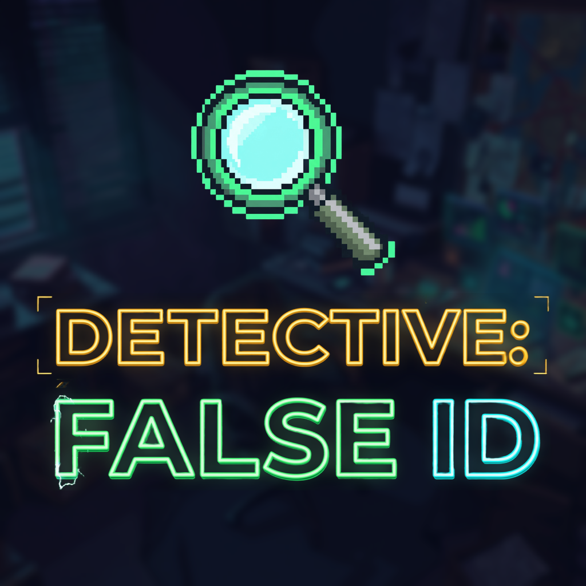
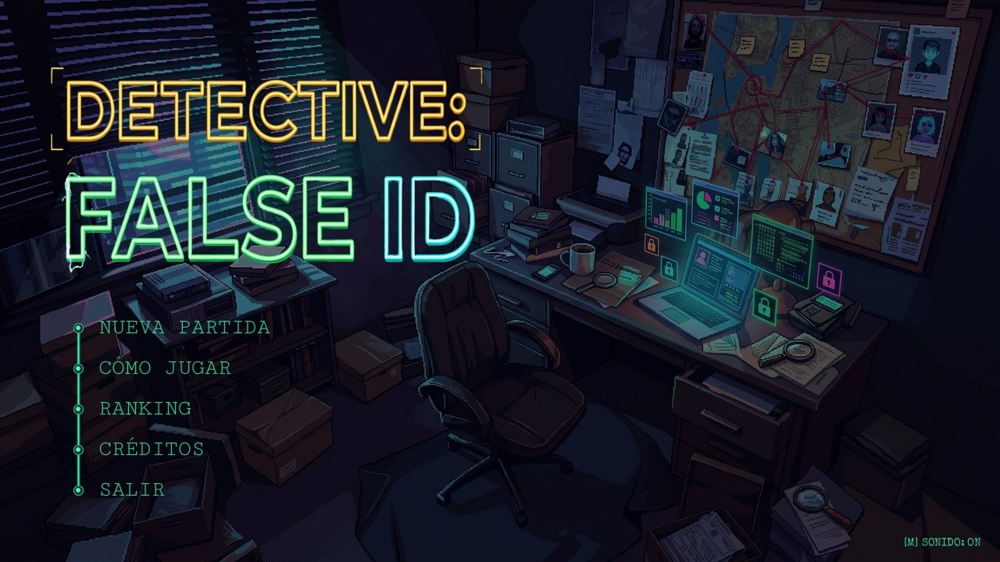
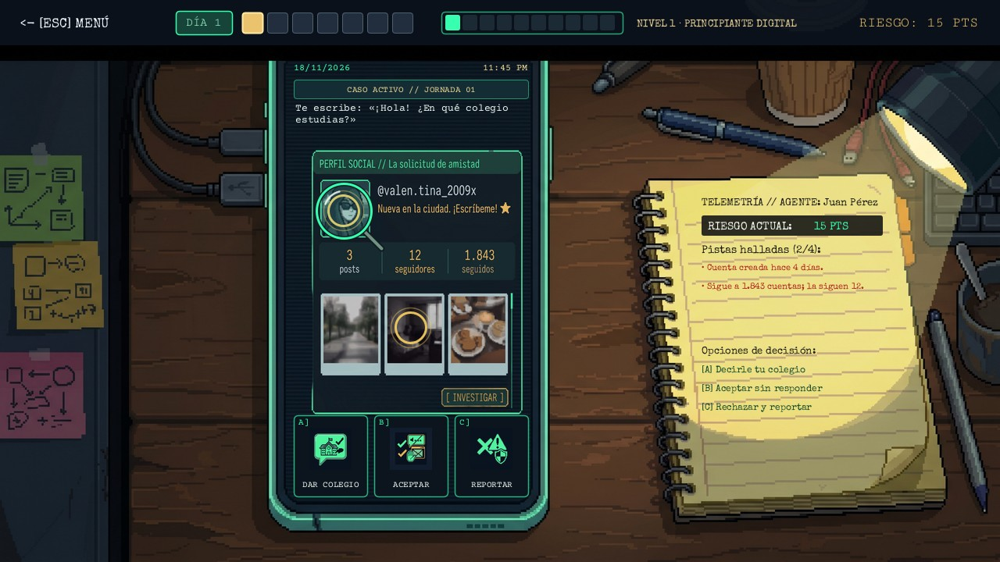
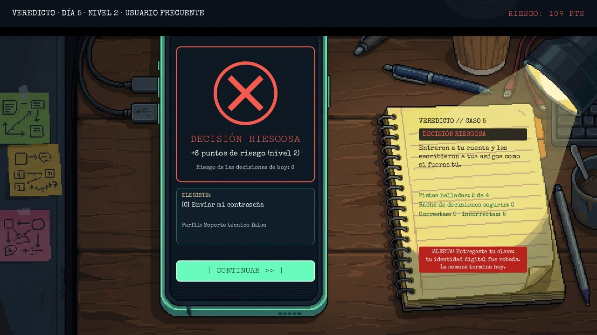
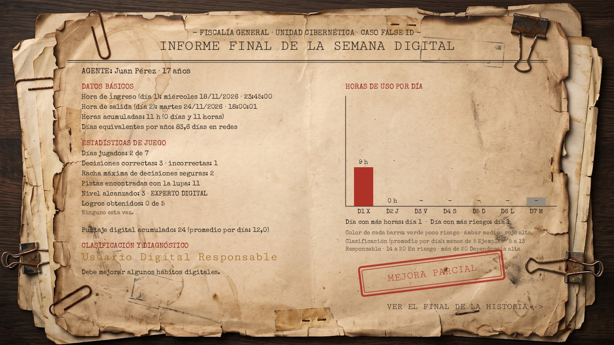
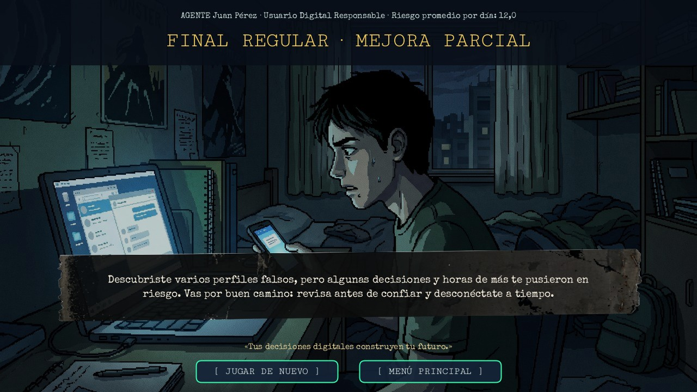
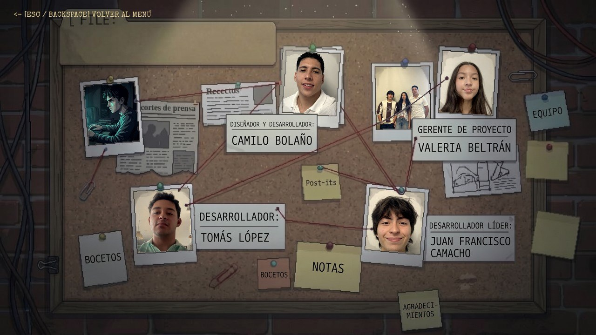

<p align="center">
  
</p>

<h1 align="center">Detective: False ID</h1>

<p align="center">
  <b>No todo perfil es quien dice ser.</b><br>
  Videojuego sobre perfiles falsos y el uso sano de las redes sociales.<br>
  🏆 <b>Primer lugar</b> · Laboratorio Único Feria Gamer 2026 · Universidad del Norte
</p>

<p align="center">
  <a href="https://www.youtube.com/watch?v=c4VY0by2IDs">▶ Ver video</a> ·
  <a href="docs/Manual_de_usuario_Detective_False_ID.pdf">Manual de usuario</a> ·
  <a href="docs/Presentacion_Detective_False_ID.pdf">Presentación</a>
</p>

---

## El juego

Una red criminal usa perfiles falsos para engañar a estudiantes en Bogotá. Eres un agente de la **Unidad Cibernética**: durante **7 días** registras tu propio uso de redes, investigas un perfil sospechoso cada día con una **lupa**, encuentras pistas y decides qué hacer. Cada decisión cuenta.

- **7 casos**, uno por día, con **9 perfiles ilustrados** (el día 7 trae 3 perfiles de la misma persona y solo uno es real).
- **3 niveles** de dificultad, **5 logros** y **4 finales**, incluido el robo de identidad si entregas tu contraseña.
- Consola con **fechas y horas reales**: hora militar de salida, cambio de día, mes y año, años bisiestos y día de la semana.
- **Informe final** con estadísticas, gráfico de horas por día, clasificación y diagnóstico, y **ranking** de la sesión.
- Arte, historieta, música y efectos de sonido propios.

| | |
|---|---|
|  |  |
|  |  |
|  |  |

## Cómo jugar

1. Instala [Processing 4](https://processing.org/download).
2. En Processing: **Sketch → Importar biblioteca → Gestionar bibliotecas**, busca **Sound** (The Processing Foundation) e instálala.
3. Descarga este repositorio (**Code → Download ZIP**), descomprímelo y abre `Detective_False_ID/Detective_False_ID.pde`. La carpeta debe llamarse igual que el `.pde` y tener adentro la carpeta `data`.
4. Presiona **Ejecutar** (▶).

Controles: mouse para todo, teclado para escribir, **ENTER** salta animaciones y **M** silencia la música. Más detalles en el [manual de usuario](docs/Manual_de_usuario_Detective_False_ID.pdf).

## Contenido del repositorio

```
Detective_False_ID/           El juego (Processing 4)
  ├─ Detective_False_ID.pde
  ├─ data/                      Imágenes, fuentes y sonidos
  └─ LEEME.txt
docs/                           Manual de usuario, presentación e imágenes del README
```

## Equipo · Detectives y Asociados

| Integrante | Rol |
|---|---|
| Valeria Beltrán Urquijo | Gerente del proyecto |
| Camilo Bolaño De La Hoz | Diseñador y desarrollador |
| Juan Francisco Camacho Posso | Desarrollador líder |
| Tomás López Possauner | Desarrollador |

Algoritmia y Programación I · NRC 4511 · Periodo 2026-30<br>
Profesora: Rocío del Rosario Ramos Rodríguez<br>
Ingeniería de Sistemas y Computación · Universidad del Norte

> **¡Tus decisiones digitales construyen tu futuro!**
